  

I'm a second-year CSE student at **MIT Manipal** working on **3D computer vision**, mostly 3D Gaussian Splatting.

### What I'm working on

- Whether a private detail edited out of a 3D Gaussian Splatting scene can still be recovered from the scene file *(AAAI-27 Undergraduate Consortium proposal, decision pending)*
- Object landmarks for dense 3DGS SLAM, with [@W-OK-E](https://github.com/W-OK-E) *(manuscript in preparation)*

### Things I've built

| Project | What it does |
|---|---|
| [**Heimdall**](https://github.com/Aryan241/Heimdall) | Height estimation from a single aerial image: a small decoder on a frozen Depth Anything V2, evaluated against LiDAR. Team project for Smart India Hackathon 2026. |
| [**Clean-Splate**](https://github.com/Aryan241/Clean-Splate) | Cleans an already-trained splat without retraining: SAM 2 masks from a text prompt, then a multi-view vote keeps or prunes each Gaussian. Tested on 12 Nerfbusters scenes. |

### Toolbox

  

  
  
  
  
  
  

  <picture>
    <source media="(prefers-color-scheme: dark)" srcset="https://raw.githubusercontent.com/Aryan241/Aryan241/output/github-contribution-grid-snake-dark.svg" />
    
  </picture>

[Website](https://aryan241.github.io) · [CV](https://aryan241.github.io/files/Aryan_Achary_CV.pdf) · [Email](mailto:aryanachary77@gmail.com)
